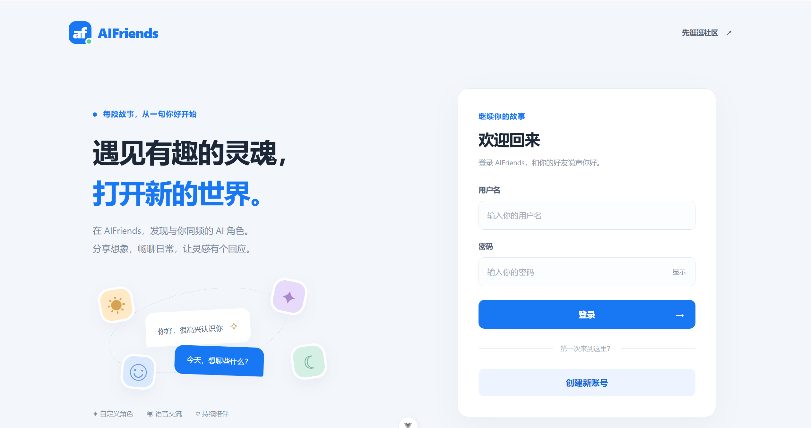
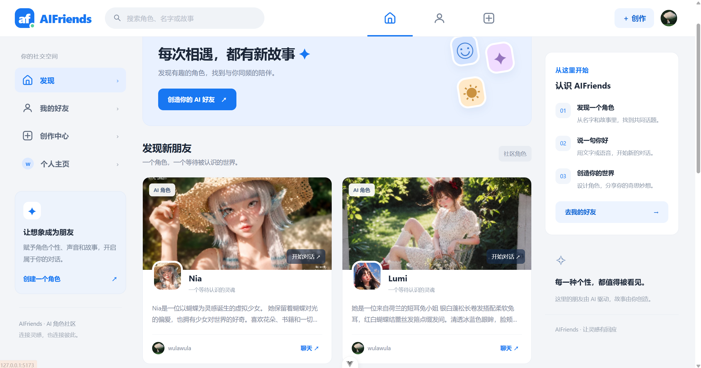
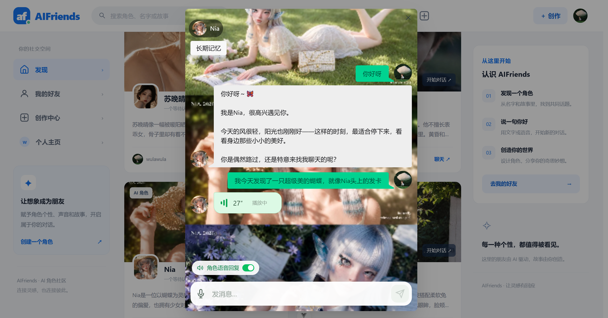
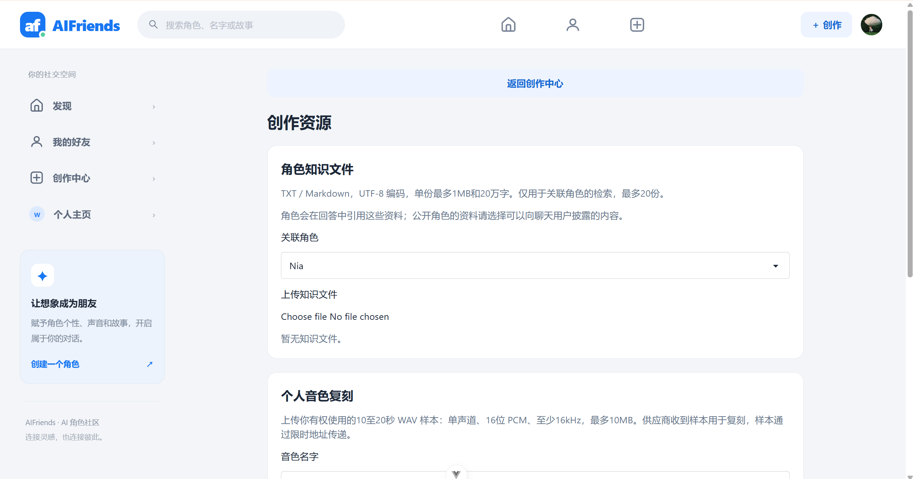
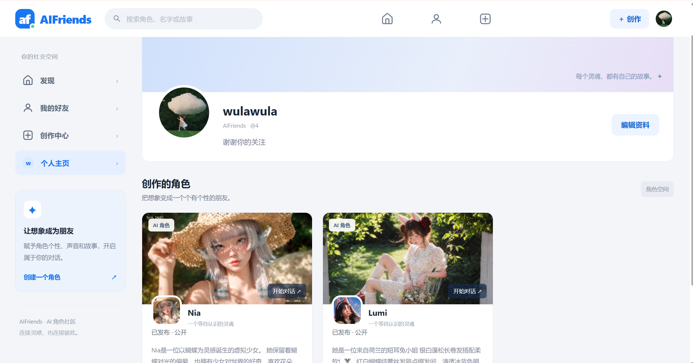

# AI friends

AI friends 是一个 AI 角色创作与对话项目。用户可以创建角色，设置形象、性格、音色和知识资料，通过文字或语音与角色交流，并继续查看历史对话。

后端使用 Django 6、Django REST Framework、SimpleJWT 和 LangGraph，前端使用 Vue 3、Vite、Pinia。默认数据库是本机 SQLite。**文字聊天支持通过 OpenAI 兼容 API 接入不同供应商的大模型**，可在配置文件中设置 API Key、基础地址和模型名称。文字与语音服务独立配置；本项目当前运行演示使用 **DeepSeek 文字聊天 + 阿里云百炼语音**，该组合是配置示例，文字模型可按接口兼容性替换。

当前语音识别与合成采用 DashScope WebSocket 任务协议。接入其他语音服务时，需要兼容该协议，或修改后端适配代码；文字模型的可替换性不代表任意语音 API 都能直接使用。

## 目录

- [功能概览](#功能概览)
- [系统运行演示](#系统运行演示)
- [运行环境](#运行环境)
- [首次安装](#首次安装)
- [配置 backend/.env](#配置-backendenv)
- [启动与访问](#启动与访问)
- [Docker运行](#docker运行)
- [停止、重启与更新](#停止重启与更新)
- [数据库、文件和前后端地址](#数据库文件和前后端地址)
- [启用可选功能](#启用可选功能)
- [检查配置与运行测试](#检查配置与运行测试)
- [生产部署](#生产部署)
- [常见问题](#常见问题)
- [项目结构与进一步阅读](#项目结构与进一步阅读)

## 功能概览

| 功能 | 当前实现 |
|---|---|
| 账号与资料 | 注册、登录、刷新登录状态、退出、头像和简介编辑 |
| 角色管理 | 创建、编辑、私有草稿、发布范围、可选审核、归档与恢复、二次确认永久删除 |
| 好友与历史 | 继续会话，归档保留完整消息、语音及知识来源 |
| 文字聊天 | 流式回复、发送/停止按钮、失败重试、请求去重、时间工具 |
| 语音输入与回复 | 录音识别、角色语音气泡、播放、展开原回复文字 |
| 角色音色 | 多种预设音色、试听、选择、更换；每个角色选择一个音色或仅文字 |
| 角色知识 | UTF-8 TXT/Markdown 文件上传、后台索引、关键词检索；可选向量检索 |
| 长期记忆 | 查看、编辑、清空、会话开关；可选后台自动摘要 |
| 个人音色复刻 | 授权样本上传、任务查询、引用保护、删除流程，需要额外外部配置 |
| 基础管理 | Django admin、举报反馈、任务状态、管理员健康接口 |

当前文字、语音合成、ASR 测试样本和知识问答已有本地真实调用证据。个人音色复刻、真实人声设备、可选嵌入、自动摘要及生产环境的剩余验收条件见[验收报告](docs/ACCEPTANCE.md)。收藏、标签、推荐和运营看板属于后续规划。

## 系统运行演示

以下为 2026 年 10 月 11 日的本地运行截图，展示从登录、发现角色到文字与语音对话的主要页面。截图中的账号、角色和对话属于演示数据，新安装的环境需要自行注册账号并创建角色。

### 1. 登录与注册

登录页面提供用户名、密码输入和密码显示切换。已有账号可直接登录，首次使用可点击“创建新账号”进入注册流程，也可以通过右上角“先逛逛社区”浏览社区。



### 2. 发现角色

“发现”页面以卡片展示社区角色的封面、头像、名称、简介和创作者。用户可以通过顶部搜索框查找角色，点击“开始对话”或“聊天”进入会话，也可以通过“创造你的 AI 好友”开始创建自己的角色。截图展示了 Nia 和 Lumi 两个演示角色。



### 3. 文字聊天与角色语音回复

聊天窗口展示用户消息和角色回复，并使用角色图片作为会话背景。底部提供文字输入、麦克风入口和“角色语音回复”开关；截图中既有文字回复，也有正在播放的 27 秒语音气泡。左上角“长期记忆”按钮用于进入记忆管理。文字回复需要配置文字服务，语音输入和语音回复分别需要配置 ASR 和 TTS 服务。



### 4. 创作资源：角色知识与个人音色

创作资源页面可选择关联角色并上传 UTF-8 编码的 TXT / Markdown 知识文件，为角色回答提供参考资料。截图中已选择 Nia，尚未上传知识文件；页面下方展示个人音色复刻的样本要求与填写入口。知识文件上传后需要任务工作器处理，个人音色复刻还需要额外的供应商接口与公网地址配置，具体见[启用可选功能](#启用可选功能)。



### 5. 个人主页与角色展示

个人主页展示用户头像、用户名和简介，用户可通过“编辑资料”修改个人信息。下方“创作的角色”集中展示该用户创建的角色及发布范围；截图中的 Nia 和 Lumi 均标记为“已发布 · 公开”，可从角色卡片进入对话。



## 运行环境

| 工具/服务 | 要求 | 用途 |
|---|---|---|
| Git | 已安装，可访问仓库 | 获取和更新代码 |
| Python | **3.12 及以上** | Django 后端和任务工作器 |
| Node.js | **20.x 且不低于 20.19，或 22.12 及以上** | 前端安装、开发和构建；21.x 不符合当前 engines |
| npm | 随 Node.js 安装 | 安装 package-lock.json 锁定的前端依赖 |
| 数据库 | 默认 SQLite，无需另装数据库服务 | 存储账号、角色、消息和任务 |
| 文字 API | 支持 OpenAI 兼容聊天接口，需有效密钥、基础地址和模型名称 | 启用 AI 回复，可切换供应商及模型 |
| 语音 API | 可选；需兼容项目的 DashScope WebSocket 协议 | 启用 ASR/TTS |

检查本机版本：

```text
git --version
python --version
node --version
npm --version
```

Windows 如果 `python` 不可用，可以用 `py -3 --version` 检查，再将下文创建虚拟环境的 `python` 换成 `py -3`。macOS/Linux 可使用 `python3`。先确认选中的 Python 满足版本要求。

## 首次安装

以下步骤先安装依赖，再配置服务，最后启动。已经安装的项目更新方法见[停止、重启与更新](#停止重启与更新)，**不要再次覆盖已有 `.env`**。

第一次运行请按下表顺序操作；配置说明较长，可以先完成最小配置，再按需要开启语音等功能。

| 顺序 | 操作 | 完成标志 |
|---|---|---|
| 1 | 获取代码，进入项目根目录 | 当前目录能看到 `README.md`、`backend`、`frontend` |
| 2 | 创建 `.venv` 并安装后端依赖 | pip 命令正常结束，没有安装失败信息 |
| 3 | 在 `frontend` 中执行 `npm ci`，再回到根目录 | npm 命令正常结束，生成 `frontend/node_modules` |
| 4 | 复制并编辑 `backend/.env` | 文件名正确；需要 AI 回复时已填写文字服务三项配置 |
| 5 | 执行数据库迁移、前端构建和 Django 检查 | 迁移成功、构建成功，检查没有错误 |
| 6 | 按[启动与访问](#启动与访问)启动服务 | 后端、前端和任务工作器均在运行 |
| 7 | 打开 `http://127.0.0.1:5173/`，注册并创建角色 | 能登录、保存角色；配置文字 API 后能收到 AI 回复 |

每个命令块按顺序执行；如果某条命令报错，先处理报错，再继续下一步。**已在 IDE 中打开或解压了本项目的用户，直接使用当前项目文件夹，跳过 `git clone`。** 文件夹名称不必是 `AI-friends`，以本机实际路径为准。

### 1. 获取项目

```text
git clone https://github.com/xiaoxiang-le/AI-friends.git
cd AI-friends
```

下面除明确要求进入 `frontend` 的步骤外，都从仓库根目录执行。

在 VS Code 中可通过“终端 → 新建终端”打开 PowerShell；用 `Get-Location` 查看当前目录。如果不在项目根目录，先执行 `Set-Location "你的项目完整路径"`（替换为真实路径；路径含空格时保留引号）。macOS/Linux 使用 `pwd` 查看目录、`cd "你的项目完整路径"` 切换目录。

### 2. 创建 Python 环境并安装后端依赖

Windows PowerShell：

```powershell
python -m venv .venv
& .\.venv\Scripts\python.exe -m pip install --upgrade pip
& .\.venv\Scripts\python.exe -m pip install -r requirements-runtime.txt
```

macOS/Linux：

```bash
python3 -m venv .venv
.venv/bin/python -m pip install --upgrade pip
.venv/bin/python -m pip install -r requirements-runtime.txt
```

使用根目录的 `requirements-runtime.txt` 安装当前运行依赖。根目录原 `requirements.txt` 是历史完整环境清单；不要只安装 Django，也不要混用多个依赖文件。直接指定 `.venv` 中的 Python，无需先激活环境。

### 3. 安装前端依赖

各平台均执行：

```text
cd frontend
npm ci
cd ..
```

`npm ci` 使用仓库中的锁文件。完成后应有 `frontend/node_modules`。项目通过 `predev` / `prebuild` 将 VAD 模型和 WASM 从本地依赖复制到 `frontend/public/vad`，不用手工下载模型。

### 4. 创建配置文件

Windows PowerShell：

```powershell
if (!(Test-Path -LiteralPath backend/.env)) {
    Copy-Item -LiteralPath backend/.env.example -Destination backend/.env
}
notepad backend/.env
```

macOS/Linux：

```bash
test -f backend/.env || cp backend/.env.example backend/.env
# 使用编辑器打开 backend/.env，按下一节填写。
```

文件必须是 **`backend/.env`**，不是根目录 `.env`，也不是 `.env.txt`。供应商密钥由后端读取，不填写到前端文件中。

### 5. 初始化数据库并构建页面

配置完成后，Windows PowerShell：

```powershell
& .\.venv\Scripts\python.exe backend/manage.py migrate --noinput
cd frontend
npm run build
cd ..
& .\.venv\Scripts\python.exe backend/manage.py check
```

macOS/Linux：

```bash
.venv/bin/python backend/manage.py migrate --noinput
cd frontend
npm run build
cd ..
.venv/bin/python backend/manage.py check
```

迁移会建立账号、角色、消息、任务等表以及默认音色。首次构建前，Django可能提示 `staticfiles.W004`（静态目录尚不存在）；先完成build，再运行check核对。构建会生成 `backend/static/frontend` 并自动更新 Django 的入口模板。仅安装依赖而不构建时，8000 端口的打包页面可能无法加载；5173 开发页面由 Vite 提供。

迁移输出中的 `OK` 或 `No migrations to apply` 都表示该步骤已完成；前端应显示构建成功，最后的 `check` 应没有错误。完成后继续“启动与访问”，这些安装命令本身不会启动网站。

## 配置 backend/.env

### 1. 最少需要配置什么

- 只浏览页面、注册登录、管理角色：不需要外部 API；保留开发环境配置，先执行迁移。
- 启用文字聊天：填写所选 OpenAI 兼容服务的 `AI_API_KEY`、`AI_BASE_URL`、`AI_MODEL`，不限于 DeepSeek。
- 启用语音输入：额外填写 `ASR_API_KEY`、`ASR_WSS_URL`，使用账号可用的 `ASR_MODEL`。
- 启用角色语音回复：额外填写 `TTS_API_KEY`、`TTS_WSS_URL`，使用匹配音色的 `TTS_MODEL`。
- 个人音色复刻、语义检索、自动记忆：按[启用可选功能](#启用可选功能)配置。它们不阻塞基础文字聊天。

**第一次只运行文字聊天时**，在刚复制的 `backend/.env` 中找到下面三行，按所选供应商填写，其他字段先保留模板默认值。不要在文件末尾重复添加同名字段。

```dotenv
AI_API_KEY=你的文字服务API_Key
AI_BASE_URL=供应商提供的OpenAI兼容基础地址
AI_MODEL=该服务实际支持的模型名称
```

模型名称需以所选服务实际支持的名称为准。如果暂时没有 API Key，可以将这三项留空，先验证页面、注册登录和角色管理；此时无法获得 AI 回复。保存文件后返回“首次安装”的第 5 步。

### 2. 通用 API 接入配置

在 `backend/.env` 中填写你选择的模型服务配置。以下字段不指定供应商、接口地址或模型名称，均由你根据服务商文档填写；文字聊天、语音识别和语音合成分别配置。**占位文字必须替换为真实配置；未启用的语音和可选服务字段留空，不要把占位文字作为配置值保存。** 文字接口需兼容 OpenAI 聊天协议，语音接口需兼容当前后端的 DashScope WebSocket 任务协议；其他协议需要增加适配代码。

```dotenv
# 旧版共享字段：混合供应商时保持为空，使用下方各服务独立字段。
API_KEY=
API_BASE=
WSS_URL=

# 文字聊天：填写所选服务的配置。
# AI_BASE_URL 是OpenAI兼容基础地址，不是 /chat/completions 完整路径。
AI_API_KEY=你的文字服务API_Key
AI_BASE_URL=你的文字服务OpenAI兼容基础地址
AI_MODEL=你的文字模型名称
# 模型不支持工具调用时设为false。
AI_ENABLE_TOOLS=true

# 语音识别：启用时填写；密钥、地域、接口和模型必须匹配。
# WebSocket接口需兼容当前DashScope任务协议。
ASR_API_KEY=你的语音识别服务API_Key
ASR_WSS_URL=你的语音识别WebSocket接口地址
ASR_MODEL=你的语音识别模型名称

# 语音合成：启用时填写；模型需与角色选择的音色匹配。
# WebSocket接口需兼容当前DashScope任务协议。
TTS_API_KEY=你的语音合成服务API_Key
TTS_WSS_URL=你的语音合成WebSocket接口地址
TTS_MODEL=你的语音合成模型名称

# 长期记忆：手动记忆可用；自动摘要默认关闭。
MEMORY_MODEL=
MEMORY_AUTO_UPDATE=false
ENABLE_LEGACY_KNOWLEDGE=false

# 个人音色复刻：未启用时留空；不影响预设音色使用。
VOICE_URL=
PUBLIC_BASE_URL=

# 可选嵌入服务：全部留空时，角色知识库使用本地关键词检索。
EMBEDDING_API_KEY=
EMBEDDING_BASE_URL=
EMBEDDING_MODEL=

# 本地HTTP开发配置。
DJANGO_DATA_DIR=
DJANGO_DEBUG=true
DJANGO_SECRET_KEY=
DJANGO_ALLOWED_HOSTS=127.0.0.1,localhost
DJANGO_CORS_ALLOWED_ORIGINS=http://127.0.0.1:5173,http://localhost:5173
DJANGO_CSRF_TRUSTED_ORIGINS=
DJANGO_TRUST_PROXY=false

# 公开角色是否必须先由管理员审核。
REQUIRE_CHARACTER_REVIEW=false
```

`.env` 中一行一个 `名称=值`，布尔开关使用小写 `true` / `false`。操作系统已设置的同名环境变量优先于文件，因为当前 `load_dotenv` 不覆盖已有变量。修改后必须重启 Django 后端和 `run_jobs`，刷新浏览器不足以加载新配置。

### 3. 密钥、模型和接口从哪里获取

从所选服务商的控制台和官方接入文档获取以下信息：

| 服务 | 需要获取的信息 | 填写字段 |
|---|---|---|
| 文字聊天 | API Key、OpenAI 兼容基础地址、可调用的聊天模型名称 | `AI_API_KEY`、`AI_BASE_URL`、`AI_MODEL` |
| 语音识别 | API Key、兼容当前任务协议的 WebSocket 地址、识别模型名称 | `ASR_API_KEY`、`ASR_WSS_URL`、`ASR_MODEL` |
| 语音合成 | API Key、兼容当前任务协议的 WebSocket 地址、合成模型名称及匹配音色 | `TTS_API_KEY`、`TTS_WSS_URL`、`TTS_MODEL` |

**文字模型接入**：后端通过 `ChatOpenAI` 调用服务，接口需兼容 OpenAI 聊天请求与流式输出。更换服务时一起修改文字服务的三个字段，模型名称必须是该账号实际可调用的名称。不支持工具调用的模型设置 `AI_ENABLE_TOOLS=false`。非 OpenAI 兼容接口需要增加后端适配。

**语音服务接入**：按服务商文档核对密钥所属账号、业务空间、地域、接口地址及模型权限。当前后端采用 DashScope WebSocket 任务协议；协议不同的服务需要适配请求、音频传输和响应处理，不能仅更换地址。语音合成还需确保角色音色与模型兼容。

配置完成后重启 Django 后端和 `run_jobs`，先发送文字消息验证 AI 回复，再按需测试音色试听和录音识别。文字、ASR 和 TTS 的密钥分别属于对应服务，不要混用；未启用语音时可只配置文字服务。

### 4. 字段说明与回退关系

| 字段 | 必填条件 | 内容/默认行为 |
|---|---|---|
| `API_KEY` / `API_BASE` / `WSS_URL` | 仅旧版共享配置使用 | 混合供应商留空；不要同时填互相冲突的密钥 |
| `AI_API_KEY` | 文字聊天 | 文字服务密钥；为空回退 `API_KEY` |
| `AI_BASE_URL` | 文字聊天 | OpenAI兼容基础地址；为空回退 `API_BASE` |
| `AI_MODEL` | 文字聊天 | 账号实际可用模型；无自动默认模型 |
| `AI_ENABLE_TOOLS` | 可保留默认 | 默认true；false不绑定时间等工具 |
| `ASR_API_KEY` / `ASR_WSS_URL` | 语音识别 | 分别回退 `API_KEY` / `WSS_URL` |
| `ASR_MODEL` | 可保留默认 | 默认fun-asr-realtime；按账号模型与协议验证 |
| `TTS_API_KEY` / `TTS_WSS_URL` | 语音回复或试听 | 分别回退 `API_KEY` / `WSS_URL` |
| `TTS_MODEL` | 可保留默认 | 默认cosyvoice-v3-flash；音色必须匹配模型 |
| `MEMORY_MODEL` | 可选 | 留空复用AI_MODEL及文字服务凭据 |
| `MEMORY_AUTO_UPDATE` | 可选 | 默认false；true才安排自动摘要任务 |
| `ENABLE_LEGACY_KNOWLEDGE` | 保留false | 老共享演示表，不是角色知识文件功能的开关 |
| `VOICE_URL` | 个人音色复刻 | 供应商HTTP复刻接口完整地址，必须HTTPS |
| `PUBLIC_BASE_URL` | 个人音色复刻 | 本应用公网HTTPS根地址，供供应商下载限时样本 |
| `EMBEDDING_API_KEY` / `EMBEDDING_BASE_URL` / `EMBEDDING_MODEL` | 可选语义检索 | 三项一起配置；不回退文字服务字段 |
| `REQUIRE_CHARACTER_REVIEW` | 可选 | 默认false；true开启公开角色先审后发 |

## 启动与访问

### Windows：一键启动

完成安装、配置和构建后，在根目录执行：

```powershell
.\start-local.ps1
```

脚本要求8000和5173端口空闲；启动Django、Vite和任务worker，记录日志与PID。若PowerShell策略禁止运行脚本，可使用下面的手动方式，不必修改系统全局执行策略。

脚本会在后台启动三个服务，打印前后端地址和日志目录后返回命令提示符，这是正常行为；不会自动打开浏览器。等待服务启动后，手动打开 `http://127.0.0.1:5173/`。如果暂时无法访问，先检查下方日志，不要连续重复执行启动脚本。

```powershell
Get-Content -LiteralPath .local/backend-error.log -Tail 50
Get-Content -LiteralPath .local/frontend.log -Tail 50
Get-Content -LiteralPath .local/frontend-error.log -Tail 50
Get-Content -LiteralPath .local/jobs-error.log -Tail 50
```

### Windows：手动启动

打开三个终端，**每个终端先进入仓库根目录**。不要在一个终端逐行运行三个长期进程。

三个终端运行期间都要保持打开。推荐依次启动后端、任务工作器和前端；某个终端报错退出时，先修复该服务，再重新执行对应命令。

终端1：Django后端。

```powershell
& .\.venv\Scripts\python.exe backend/manage.py runserver 127.0.0.1:8000 --noreload
```

终端2：任务worker。

```powershell
& .\.venv\Scripts\python.exe backend/manage.py run_jobs
```

终端3：前端开发服务。

```powershell
cd frontend
npm run dev -- --host 127.0.0.1 --port 5173 --strictPort
```

后端终端出现 `Starting development server at http://127.0.0.1:8000/`，前端终端显示 `http://127.0.0.1:5173/`，表示这两个服务已开始监听。任务工作器会持续等待任务，没有输出也可能是正常状态；如果命令直接退出或显示异常堆栈，则需要处理报错。

### macOS/Linux：手动启动

同样使用三个终端，每个终端从仓库根目录开始：

```bash
# 终端1
.venv/bin/python backend/manage.py runserver 127.0.0.1:8000 --noreload
```

```bash
# 终端2
.venv/bin/python backend/manage.py run_jobs
```

```bash
# 终端3
cd frontend
npm run dev -- --host 127.0.0.1 --port 5173 --strictPort
```

| 地址 | 用途 | 依赖 |
|---|---|---|
| http://127.0.0.1:5173/ | 前端开发页面，支持热更新 | Vite + Django |
| http://127.0.0.1:8000/ | 打包页面 | 已build + Django |
| http://127.0.0.1:8000/admin/ | 管理后台 | Django + 管理员账号 |
| http://127.0.0.1:8000/api/capabilities/ | 查看配置是否完整 | Django；不需要登录 |

首次访问先注册账号。可按“创作中心 → 新建角色 → 保存草稿 → 开始聊天”验证基础流程，再选择角色语音回复或语音输入。知识索引、复刻和自动摘要需要worker；只开Django和Vite会使这些任务停在排队状态。

建议按以下顺序确认运行结果：

1. 打开 `http://127.0.0.1:5173/`，确认页面正常显示。
2. 注册普通账号并登录，刷新页面，确认登录状态保留。
3. 创建角色并保存草稿，进入聊天，发送一句文字；已配置文字服务时，应看到 AI 回复。未配置语音时，先使用仅文字模式。
4. 需要语音时，再配置 ASR/TTS、重启后端与工作器，验证音色试听和麦克风录音；浏览器询问麦克风权限时允许使用。

页面能打开只说明前端可访问；注册登录成功才能验证后端和数据库连接，收到 AI 回复才能验证文字服务配置。

创建管理员（不是普通用户注册的必需步骤）：

```powershell
& .\.venv\Scripts\python.exe backend/manage.py createsuperuser
```

macOS/Linux将解释器替换为 `.venv/bin/python`。管理员用户名和密码由你自行输入。

## Docker运行

仓库提供多阶段 [Dockerfile](Dockerfile)、[Compose配置](compose.yaml)和[服务器HTTPS覆盖配置](compose.production.yaml)。下面先在本机完成 HTTP 容器部署，再说明服务器 HTTPS 部署。所有命令均从项目根目录执行。

### 1. 准备 Docker 环境

- Windows/macOS：安装 Docker Desktop，启动后等待引擎就绪；Windows 使用 Linux 容器模式，根据安装提示完成 WSL 2 配置。
- Linux 服务器：安装 Docker Engine 和 Docker Compose 插件。
- 本项目要求 Compose **2.30 及以上**，统一使用 `docker compose` 命令。
- 构建时需要访问镜像仓库、npm 和 PyPI；本机无需另外安装 Python、Node.js、虚拟环境或执行 `npm ci`。

在终端检查：

```text
docker version
docker compose version
docker info
```

`docker version` 应显示 Client 和 Server 信息，`docker info` 应正常返回引擎信息。如果提示无法连接 Docker daemon，先启动 Docker Desktop 或 Linux Docker 服务，再继续。

### 2. 准备应用配置

已有 `backend/.env` 时继续使用，不要覆盖。首次部署可复制模板：

Windows PowerShell：

```powershell
if (!(Test-Path -LiteralPath backend/.env)) {
    Copy-Item -LiteralPath backend/.env.example -Destination backend/.env
}
notepad backend/.env
```

macOS/Linux：

```bash
test -f backend/.env || cp backend/.env.example backend/.env
# 用编辑器打开 backend/.env。
```

按[配置 backend/.env](#配置-backendenv)填写所选服务的文字 API 密钥、基础地址和模型；语音及可选功能按需配置。只验证注册登录和角色管理时，可以不填外部 API。**本机 HTTP 部署**确认以下设置：

```dotenv
DJANGO_DEBUG=true
DJANGO_ALLOWED_HOSTS=127.0.0.1,localhost
DJANGO_TRUST_PROXY=false
```

Compose 自动设置 `DJANGO_DATA_DIR=/data`，不要改为本机 Windows 路径。密钥通过 `env_file` 在容器启动时注入，不作为镜像构建参数。若值包含字面量 `$`，按 Compose 规则用单引号保护。配置检查使用 `config --quiet`，避免输出展开后的密钥。

### 3. 构建并启动容器

```text
docker compose config --quiet
docker compose up --build -d
docker compose ps -a
docker compose logs --tail=80 init web worker nginx
```

`config --quiet` 成功时通常没有输出。`--build` 构建镜像，`-d` 在后台运行；首次需要下载镜像和依赖，耗时取决于网络。若命令失败，先查看报错，再继续下一步。

| 服务 | 作用 | 正常状态 |
|---|---|---|
| `init` | 检查数据目录、执行迁移、收集静态文件 | 完成后 `Exited (0)`，属于正常退出 |
| `web` | Gunicorn 运行 Django 后端 | `Up`，健康检查最终为 `healthy` |
| `worker` | 执行知识索引、记忆和音色任务 | `Up`，健康检查最终为 `healthy` |
| `nginx` | 提供页面资源、公开图片和聊天流代理 | `Up`，健康检查最终为 `healthy` |

启动顺序为 `init` 完成 → `web` 与 `worker` 启动 → 后端健康 → `nginx` 启动。刚启动时显示 `starting` 可等待后再执行 `docker compose ps -a`；如果 `init` 非零退出或服务持续 `unhealthy`，检查对应日志。健康检查失败不会单独触发自动重启。

### 4. 访问并验证

打开 **http://127.0.0.1:8080/**。容器方案已构建前端，无需运行 `start-local.ps1`、Vite 或本机 Django；默认不占用本机 8000/5173 端口。

1. 注册新账号并登录，刷新页面确认登录状态保留。
2. 创建角色、保存并进入聊天；配置文字 API 后确认能收到流式回复。
3. 按需测试音色试听、录音和知识文件上传，确认后台任务可以完成。
4. 停止并重新启动容器后，确认账号、角色和历史消息仍在。

可检查健康接口，但该接口不会验证外部模型服务是否可调用：

```text
curl http://127.0.0.1:8080/api/health/
```

需要管理员账号时执行：

```text
docker compose exec web python manage.py createsuperuser
```

按提示创建账号后访问 http://127.0.0.1:8080/admin/ 。

### 5. 日常管理与数据保留

```text
# 查看服务状态
docker compose ps -a
# 持续查看日志，Ctrl+C 只退出日志查看
docker compose logs -f --tail=80 web worker nginx
# 停止并移除容器，保留数据卷
docker compose down
# 使用现有镜像重新启动
docker compose up -d
```

代码、依赖或 `backend/.env` 更新后，先备份数据，再执行以下命令，使容器重新读取配置、执行迁移并更新页面资源；仅 `restart` 不会读取修改后的 `env_file`：

```text
docker compose down
docker compose up --build -d
docker compose ps -a
```

数据保存在命名卷 `ai-friends_app-data`，通过 `DJANGO_DATA_DIR=/data`统一定位SQLite、media、private_storage和staticfiles。本机不设置该字段时仍沿用backend目录。首次运行建立新数据库，**不会自动导入本机账号或聊天**；导入、备份及HTTPS部署边界见容器说明。`docker compose down`保留数据；`down -v`会删除卷内数据。

不要将本机整个 `backend` 目录挂载到容器的 `/app/backend`，否则会覆盖镜像内构建的页面和代码。导入已有数据需先停止写入服务，一致性备份数据库、图片和私有音频，并确认容器用户 UID 10001 有读写权限；详细边界见[数据管理说明](docker/README.md#持久化管理与更新)。

### 6. 服务器 HTTPS 部署

在服务器获取项目代码并准备 Docker 环境。将域名解析到服务器，开放 80/443 端口，并准备匹配域名的 TLS 证书；证书申请和自动续期需要另外管理。

1. 在服务器 `backend/.env` 填写强随机 `DJANGO_SECRET_KEY` 和所需 API 配置。生产覆盖文件会设置 `DJANGO_DEBUG=false`、可信代理和域名白名单。
2. 复制 `docker/production.env.example` 为 `docker/production.env`，填写以下内容：

```dotenv
APP_DOMAIN=你的实际域名
TLS_CERT_DIR=/服务器上的证书绝对目录
DOCKER_BIND_IP=0.0.0.0
```

`APP_DOMAIN` 不带协议、端口或路径；证书目录中必须有 `fullchain.pem` 和 `privkey.pem`。`backend/.env` 是应用配置，`docker/production.env` 是 Compose 部署变量，两份文件均不提交到仓库。个人音色复刻启用时，还需设置 `PUBLIC_BASE_URL=https://你的实际域名`。

从服务器项目根目录按顺序执行：

```bash
docker compose --env-file docker/production.env -f compose.yaml -f compose.production.yaml config --quiet
docker compose --env-file docker/production.env -f compose.yaml -f compose.production.yaml build
docker compose --env-file docker/production.env -f compose.yaml -f compose.production.yaml run --rm --no-deps init
docker compose --env-file docker/production.env -f compose.yaml -f compose.production.yaml run --rm --no-deps nginx nginx -t
docker compose --env-file docker/production.env -f compose.yaml -f compose.production.yaml up -d
docker compose --env-file docker/production.env -f compose.yaml -f compose.production.yaml ps -a
```

先初始化数据卷，再验证 Nginx 配置；每一步成功后继续。访问 `https://你的实际域名/`，确认 HTTP 自动跳转 HTTPS，并验证登录、聊天流和上传功能。生产覆盖文件将本机 8080 入口替换为 80/443；TLS 由容器内 Nginx 提供，Gunicorn 只在容器网络中开放。

生产环境的日志、管理员创建、停止和更新命令，都必须带同样的 `--env-file docker/production.env -f compose.yaml -f compose.production.yaml` 参数。例如查看日志：

```bash
docker compose --env-file docker/production.env -f compose.yaml -f compose.production.yaml logs --tail=80 init web worker nginx
```

不要用仓库根目录的旧 `nginx.conf` 替换容器配置：旧示例使用 uWSGI 协议，容器中的 Gunicorn 使用 HTTP 代理。已有外层 HTTPS 网关时需单独调整代理拓扑，见[HTTPS 部署说明](docker/README.md#https生产部署)。

### 7. 常见部署问题

| 问题 | 处理 |
|---|---|
| 无法连接 Docker daemon | 确认 Docker 引擎已启动，Windows 使用 Linux 容器模式 |
| 镜像拉取或依赖下载超时 | 检查 Docker 的网络与代理配置，以及镜像仓库、npm、PyPI 的连通性 |
| 8080 被占用 | 停止占用该端口的服务，或修改基础 Compose 的宿主机端口后用新端口访问 |
| `init` 非零退出 | 查看 `docker compose logs --tail=80 init`，检查配置、迁移和卷写权限 |
| 页面能打开但 AI 无回复 | 核对文字 API 三项配置，重建容器以加载配置，并查看 `web` 日志 |
| 任务一直排队 | 检查 `worker` 状态和日志，确认对应外部服务配置可用 |
| 本机 HTTP 被跳转到 HTTPS | 基础 Compose 下保持 `DJANGO_DEBUG=true`；正式 HTTPS 使用生产覆盖文件 |
| HTTPS 服务启动失败 | 检查域名、证书文件名/路径、80/443 占用及 `nginx -t` 输出 |
| 容器中没有本机账号 | 新卷使用新数据库；已有数据需按迁移说明导入 |

截至本次文档更新，已确认本机 Docker 引擎可连接、Compose 可用，基础配置通过 `docker compose config --quiet` 检查。本次未执行镜像构建与容器启动；配置解析通过不代表部署功能已验收，仍需按上面的流程验证。

## 停止、重启与更新

### 手动启动的服务

在对应终端按 `Ctrl+C` 停止；重新执行各自启动命令。`.env` 修改后重启后端与worker；`--noreload`模式修改Python代码也需要重启。

### 一键启动的服务

从根目录查看启动记录和命令行：

```powershell
$runInfo = Get-Content -LiteralPath .local/pids.json -Raw | ConvertFrom-Json
$allProcesses = Get-CimInstance Win32_Process
$allProcesses | Where-Object {
    $_.ProcessId -in @($runInfo.backend, $runInfo.frontend, $runInfo.jobs) -or
    $_.ParentProcessId -in @($runInfo.backend, $runInfo.jobs)
} | Select-Object ProcessId, ParentProcessId, ExecutablePath, CommandLine
```

确认输出中的进程确实属于本项目后，用 `Stop-Process -Id 你核对过的进程号` 停止相应启动器及Python子进程。PID可能被系统重复使用，不要直接停止全部python/node进程。全部停止后重新运行 `start-local.ps1`。

日志包括 `.local/backend-error.log`、`.local/frontend-error.log`、`.local/jobs-error.log` 及对应标准输出日志。例如：

```powershell
Get-Content -LiteralPath .local/backend-error.log -Tail 80
Get-Content -LiteralPath .local/jobs-error.log -Tail 80
```

手动启动时日志主要显示在各终端中。

### 更新已有安装

先停止服务并备份数据，确认已有代码修改已提交或另行保存，再执行：

```powershell
git pull --ff-only origin main
& .\.venv\Scripts\python.exe -m pip install -r requirements-runtime.txt
& .\.venv\Scripts\python.exe backend/manage.py migrate --noinput
cd frontend
npm ci
npm run build
cd ..
.\start-local.ps1
```

macOS/Linux使用对应解释器，随后按手动方式启动。新增环境字段从模板对照补入现有 `.env`，不覆盖密钥。`--ff-only`遇到分叉会停止；先检查分支差异再决定合并。新build后重启无重载Django，以免缓存入口模板仍引用旧JS/CSS。

## 数据库、文件和前后端地址

**数据库**：默认使用 `backend/db.sqlite3`；设置可选的 `DJANGO_DATA_DIR` 后使用该目录下的 `db.sqlite3`，Compose自动设为 `/data`。不需要配置 `DB_HOST`、MySQL密码或启动数据库服务器；不存在自动读取数据库连接字符串的配置。如果要换PostgreSQL/MySQL，需修改Django数据库配置、安装驱动并单独迁移验收。

| 路径 | 内容 | 是否随Git提交 |
|---|---|---|
| `backend/.env` | 本机供应商与部署配置 | 否 |
| `backend/db.sqlite3` | 用户、角色、聊天、知识、任务等 | 否 |
| `backend/media` | 用户头像与角色图片 | 用户上传不提交，仓库保留默认头像 |
| `backend/private_storage` | 私人聊天语音和复刻样本 | 否；不通过公共media直接提供 |
| `backend/static/frontend` | 前端build生成页面、JS/CSS/VAD资源 | 否，由build生成 |
| `backend/staticfiles` | collectstatic生成的生产静态资源 | 否 |
| `.local` | 一键启动日志和PID | 否 |

**前端连接地址**在 `frontend/src/js/config/config.js`：开发时连接 `http://127.0.0.1:8000`，打包后使用页面当前域名。当前没有实现 `VITE_API_BASE_URL` 配置，向前端 `.env` 随意添加该字段不会改地址。

本地统一使用 `127.0.0.1` 访问前后端，避免`localhost`与IP混用导致Cookie登录恢复异常。如果改后端端口/域名，同步检查该前端配置、后端CORS/CSRF白名单及启动命令；若改开发端口，同步修改CORS允许的前端来源。默认开发服务仅绑定本机地址。

## 启用可选功能

### 角色知识与可选语义检索

在“创作中心 → 知识、音色与任务”选择角色，上传UTF-8 TXT/Markdown，等待任务完成。每角色最多20份，每份最多1MB/20万字符。默认关键词方案无需另外购买或配置嵌入服务。

需要语义检索时，填写全部 `EMBEDDING_*` 字段：密钥、OpenAI兼容嵌入基础地址、实际嵌入模型。该接口必须支持embeddings，不要填只提供聊天的模型。重启worker后重新导入需要向量化的文档；旧就绪关键词文档不会自动重建。

### 自动长期记忆

手动记忆可直接使用。需要自动摘要时设 `MEMORY_AUTO_UPDATE=true` 并运行worker；每10条成功对话安排摘要。`MEMORY_MODEL`空值复用文字模型，不需要独立摘要密钥。会话中关闭记忆后不读取/更新，手动保存和清空有版本保护。

### 个人音色复刻

预设音色只需要TTS配置。创建自己的音色额外需要：

```dotenv
# 北京业务空间示例；WorkspaceId替换为自己的真实业务空间ID。
VOICE_URL=https://你的WorkspaceId.cn-beijing.maas.aliyuncs.com/api/v1/services/audio/tts/customization
# 替换为本应用已部署、供应商能够访问的公网HTTPS域名。
PUBLIC_BASE_URL=https://你的应用域名
```

`VOICE_URL`是阿里云复刻服务地址，`PUBLIC_BASE_URL`是你的网站地址，两者用途不同。后者不能填DeepSeek地址或localhost；供应商需要下载本应用生成的限时样本URL。本项目旧北京HTTP复刻地址示例为 `https://dashscope.aliyuncs.com/api/v1/services/audio/tts/customization`，新接入按[官方声音复刻文档](https://help.aliyun.com/zh/model-studio/voice-cloning-user-guide)匹配账号地域、目标模型与地址。

在资源页提交拥有使用授权的10至20秒、单声道、16位PCM、至少16kHz、最多10MB的WAV样本，运行worker处理。成功音色才能在角色编辑中选择；被角色引用时不能直接删除。提交结果不确定的失败需管理员核对云端资源后处理，不要反复创建。

### 公开角色审核

`REQUIRE_CHARACTER_REVIEW=true`开启公开角色先审后发。管理员通过 `/admin/` 将角色状态设为published或rejected并填写拒绝原因；作者可查看结果。默认false时沿用直接发布流程。

## 检查配置与运行测试

Windows PowerShell，从根目录执行：

```powershell
& .\.venv\Scripts\python.exe backend/manage.py check
& .\.venv\Scripts\python.exe backend/manage.py makemigrations --check --dry-run
& .\.venv\Scripts\python.exe backend/manage.py test web --noinput
cd frontend
npm test
npm run build
cd ..
```

macOS/Linux使用 `.venv/bin/python` 替换解释器。最近一次功能回归为81项后端和9项前端通过，证据保留在[验收报告](docs/ACCEPTANCE.md)。这不代表所有设备及未来供应商模型均已经验收。

服务运行后查看能力配置：

```powershell
Invoke-RestMethod http://127.0.0.1:8000/api/capabilities/ | ConvertTo-Json -Depth 6
```

macOS/Linux可执行 `curl http://127.0.0.1:8000/api/capabilities/`。`configured=true`只说明字段完整；接口不实时调用供应商，`verified=false`不是“已经测试失败”。是否实际可用要通过聊天、试听和录音验证。

## 生产部署

`runserver`与5173端口是本地开发方案。正式环境应使用WSGI服务、Nginx和独立 `run_jobs` 守护进程；仓库提供[nginx.conf](nginx.conf)与[uWSGI示例](scripts/uwsgi.ini)，需要替换实际域名、证书和路径。uWSGI等部署工具不在核心运行依赖清单中，需在目标Linux环境另外安装。

### 1. 设置生产环境变量

```dotenv
DJANGO_DEBUG=false
DJANGO_SECRET_KEY=替换为足够长的随机密钥
DJANGO_ALLOWED_HOSTS=ai.example.com
DJANGO_CORS_ALLOWED_ORIGINS=https://ai.example.com
DJANGO_CSRF_TRUSTED_ORIGINS=https://ai.example.com
# 只有可信代理覆盖X-Forwarded-Proto、后端不被绕过直访时才启用。
DJANGO_TRUST_PROXY=true
```

用自己的域名替换示例；允许来源带协议，ALLOWED_HOSTS不带协议。前后端分域部署时按实际前端来源填写白名单，并额外验证Cookie策略；本项目默认打包同域部署。生成密钥可在本机执行：

```powershell
& .\.venv\Scripts\python.exe -c "from django.core.management.utils import get_random_secret_key; print(get_random_secret_key())"
```

把输出只保存到自己的配置中。生产DEBUGfalse会要求密钥，并启用Secure Cookie、HTTPS重定向和HSTS；未配置HTTPS前不要把本地HTTP环境直接切为生产模式。

| 部署字段 | 含义 |
|---|---|
| `DJANGO_DEBUG` | 本地true，生产false |
| `DJANGO_SECRET_KEY` | Django签名密钥，不是文字/语音API密钥；本地可用开发默认值 |
| `DJANGO_ALLOWED_HOSTS` | 允许访问的域名，以英文逗号分隔 |
| `DJANGO_CORS_ALLOWED_ORIGINS` | 允许带Cookie跨域请求的前端来源，包含协议/必要端口 |
| `DJANGO_CSRF_TRUSTED_ORIGINS` | admin等CSRF表单信任的HTTPS来源 |
| `DJANGO_TRUST_PROXY` | 默认false，仅可信反向代理时true |

### 2. 构建、迁移和收集静态资源

Linux服务器根目录：

```bash
.venv/bin/python -m pip install -r requirements-runtime.txt
cd frontend
npm ci
npm run build
cd ..
.venv/bin/python backend/manage.py migrate --noinput
.venv/bin/python backend/manage.py collectstatic --noinput
.venv/bin/python backend/manage.py check --deploy
```

### 3. 启动服务并配置代理

- WSGI负责Django；示例uWSGI监听`127.0.0.1:8000` **uwsgi协议socket**，Nginx使用`uwsgi_pass`，不能混用HTTP `proxy_pass`。示例没有指定虚拟环境，启动时需保证uWSGI使用对应Python环境，必要时配置`home`。
- 独立守护worker，命令为 `.venv/bin/python backend/manage.py run_jobs`，工作目录设为仓库根目录。
- Nginx提供 `/static/` 与公开 `/media/`；私人音频走鉴权接口，不能把private_storage映射为公共目录。
- 聊天SSE关闭代理缓冲并留够上游超时；配置实际TLS证书后先运行 `nginx -t`，通过再加载。
- 验证HTTPS登录恢复、历史语音访问、任务重启恢复、限流与备份。生产机的Nginx/证书/负载验收尚需部署环境完成。

备份应包含SQLite数据库、`media`、`private_storage`，配置密钥另外保管。SQLite使用备份API或停服务后复制；复制正在写入的文件不等于一致性备份。恢复要在隔离环境演练。

## 常见问题

| 问题 | 检查与处理 |
|---|---|
| 注册报错或提示表不存在 | 确认使用.venv解释器，执行migrate并查看Django日志；默认SQLite不需要外部数据库账号 |
| AI提示未配置 | 检查backend/.env及AI三个字段；确认没有保存成.env.txt，重启后端/worker |
| 已配置却401/403 | 核对对应供应商密钥、地域、接口权限；不要把DeepSeek密钥用于阿里云语音 |
| 模型不存在/不支持工具 | 核对账号实际模型；必要时关闭AI_ENABLE_TOOLS；当前ASR模板使用FunASR而非强制旧Gummy |
| 页面空白或JS/CSS 404 | 安装前端依赖并build，检查Django模板引用，重启无重载后端；Vite开发页用5173 |
| npm/依赖安装失败 | 检查Node版本与仓库根/前端目录，前端执行npm ci；后端不要只安装Django |
| 8000/5173被占用 | 检查现有服务/进程归属，停止本项目旧服务；默认脚本不自行抢占或换端口 |
| 任务一直排队 | 启动run_jobs，查看jobs日志及任务错误；配置更新后worker也要重启 |
| 删除角色失败、请求返回404 HTML | 旧后端可能仍未加载新增删除路由；核对当前运行的项目目录，停止旧后端后重新启动。不要只刷新前端，也不要在旧进程未退出时重复启动服务 |
| 删除角色返回JSON错误/409 | 按返回原因处理：角色已更新先刷新；生成回复或知识/记忆任务运行中需等待结束。永久删除会清理所有用户与该角色的聊天和资料，需要保留历史时使用归档 |
| 浏览器不能录音 | 检查麦克风权限/设备，远程站点使用HTTPS；检查本地VAD模型和WASM请求 |
| 语音无法自动播放 | 浏览器可能限制自动播放，点击气泡播放；TTS失败时保留文字 |
| 登录后刷新退出/CORS错误 | 统一127.0.0.1或统一localhost，核对CORS来源；本地HTTP保持DEBUGtrue |
| 复刻提示未配置 | 除TTS外还要VOICE_URL和公网HTTPS PUBLIC_BASE_URL；普通预设音色不需要复刻配置 |
| 知识内容没有被引用 | 检查角色关联、文档任务是否完成和检索相关性；关键词检索不是所有问法都必然命中 |
| 生产反复HTTPS重定向 | 核对可信代理的X-Forwarded-Proto及DJANGO_TRUST_PROXY配置，不关闭HTTPS保护来掩盖代理配置错误 |

## 项目结构与进一步阅读

```text
AI-friends/
├── backend/
│   ├── backend/                  Django配置、WSGI和主路由
│   ├── web/
│   │   ├── models/               账号、角色、消息、知识与任务
│   │   ├── services/             供应商、音色、检索、任务、私有文件
│   │   ├── views/                账号、角色、聊天及资源接口
│   │   ├── management/commands/  run_jobs工作器
│   │   └── migrations/           数据库升级记录
│   ├── .env.example              可复制配置模板
│   └── manage.py
├── frontend/                     Vue前端、锁文件和Vite配置
├── docs/                         产品、验收及提交记录
├── scripts/                      VAD准备、构建入口同步、uWSGI示例
├── requirements-runtime.txt      当前后端运行依赖
├── start-local.ps1               Windows三服务启动
├── nginx.conf                    生产代理示例
└── LOCAL_RUN.md                  本地运行补充说明
```

音色中文名称在 `backend/web/services/voice_catalog.py` 的 `VOICE_NAMES` 中修改；供应商voice_id与展示名分开，改名不等于新增音色。

- [产品文档：设计、流程、权限和任务状态](docs/PRODUCT.md)
- [功能验收报告：测试证据与待验收条件](docs/ACCEPTANCE.md)
- [本地运行补充说明](LOCAL_RUN.md)
- [2026-10-11功能提交清单](docs/COMMITS-2026-10-11.md)
- [MIT许可证](LICENSE)

环境配置按当前源码核对；服务商模型和地域地址可能更新，接入时结合本文的项目字段与供应商官方文档验证。API Key、数据库及私人音频不提交到仓库。
